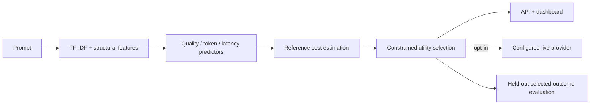
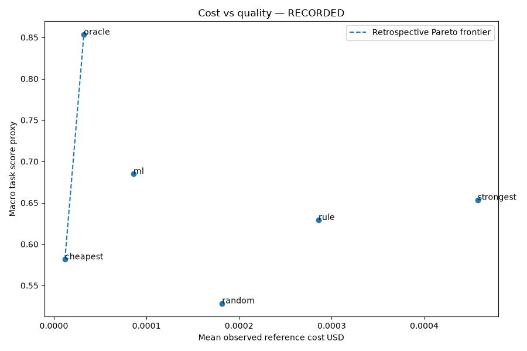

# RouteLab — Adaptive LLM Routing & Benchmark Platform

Select an LLM using learned response-quality predictions, estimated cost and estimated latency.
Compare routing strategies on the same held-out recorded executions. The routing algorithm is
implemented independently and runs on a CPU without a paid API or local LLM.

Python 3.13 · uv · NumPy · Pandas · scikit-learn · SciPy · joblib · Pydantic · FastAPI ·
Matplotlib · Hugging Face Parquet data · Streamlit

## Engineering features

- Prompt-only TF-IDF and ten structural features, persisted with per-model Ridge predictors.
- Grouped training validation selects alpha; original test executions stay held out.
- Five deployable strategies, an evaluation-only oracle and explicit no-feasible-model results.
- Configurable utility weights, candidate availability and hard estimated quality/cost/latency limits.
- Authentic xRouteBench generic adapter and candidate pricing metadata, checksums and provenance.
- Deterministic 240-prompt, three-tier **SIMULATED** dataset for offline demos and CI.
- Comparable observation matrices, task-specific reports, bootstrap intervals and Pareto charts.
- Authenticated API, interactive dashboard, optional explicitly opted-in provider execution.

## Architecture



The API, CLI and evaluation reuse the same predictor/router; Streamlit calls the API.
Observed test outcomes are absent from inference interfaces. See [architecture](docs/architecture.md)
and [evaluation methodology](docs/evaluation.md).

## Quick start — Windows PowerShell

Install Git, uv and Python 3.13, then run from the repository root:

```powershell
uv sync --locked
uv run routelab seed-demo
uv run routelab validate-data
uv run routelab train --dataset demo
uv run routelab evaluate --dataset demo
uv run routelab report --dataset demo
$env:ROUTELAB_API_TOKEN = (uv run python -c "import secrets; print(secrets.token_urlsafe(32))")
uv run uvicorn routelab.api.app:app --host 127.0.0.1 --port 8001
```

In another terminal use the same local token:

```powershell
$env:ROUTELAB_API_TOKEN = '<same token as API>'
uv run streamlit run apps/dashboard.py --server.address 127.0.0.1 --server.port 8502
```

Open http://127.0.0.1:8502. Routing playground accepts a prompt, strategy, candidate set,
estimated constraints and utility weights. It displays predicted alternatives and explanations.
Benchmark offers dataset/task/model filters, strategy tables, Pareto/latency/selection plots.
Experiment details shows provenance, splits and hyperparameters. Model insights shows predictor
error and local per-prompt decisions after evaluation. Metrics come from computed reports.
Linux/macOS use equivalent `export` commands. Keep the API and dashboard on localhost.

Runtime data and trusted model artifacts are ignored under `data/runtime/` and `artifacts/`.
`.env.example` documents environment settings; `.env` is ignored. A missing model returns 503.

## Authentic dataset and ML training

```powershell
uv run routelab download-dataset --source xroutebench
uv run routelab validate-data --dataset xroutebench
uv run routelab train --dataset xroutebench
uv run routelab evaluate --dataset xroutebench
uv run routelab report --dataset xroutebench
```

Source: [ulab-ai/xRouteBench](https://huggingface.co/datasets/ulab-ai/xRouteBench), configurations
`llmrouter_generic` and `llm_candidates`. Recorded fields include prompt, task, model response,
task score/metric, token usage and latency. Eighteen candidate models have published reference
prices. Original train/test Parquet files are preserved; latency seconds become milliseconds.
Downloads cache a pinned revision and checksums. The inspected dataset card has no explicit license;
source terms apply, and the repository's MIT license does not relicense third-party data.

Duplicate conflicts quarantine the whole affected prompt rather than averaging outcomes.
Crossing training prompt/family records are removed before fitting. Missing measurements stay
missing and incomplete matrices are reported. No response or code in the dataset is executed.
See [evaluation.md](docs/evaluation.md) for the exact 71 conflict-row / 198 overlap-row exclusions.

Per-model Ridge predicts quality; log1p Ridge predicts token usage and latency. Alpha in
{1, 10, 100} is selected inside training only. TF-IDF/scaling are fit on training, persisted and
reused at inference. The strongest reference is validation-selected, not test-selected.
Optional quick experiment (whole families, up to approximately 500 prompts **per original split**):

```powershell
uv run routelab train --dataset xroutebench --max-prompts 500
uv run routelab evaluate --dataset xroutebench
```

Omit `--max-prompts` and rerun train/evaluate for full results. To serve the real trained router,
set `ROUTELAB_ARTIFACT_DIR=artifacts/xroutebench` before starting the API.

## Routing policy

`utility = quality_weight * predicted_quality - cost_weight * estimated_cost / training_cost_p95
- latency_weight * estimated_latency / training_latency_p95`

Quality is clipped to [0,1]. Cost/latency normalization uses fixed positive training p95 scales;
ratios may exceed one. Estimated costs use predicted rounded token counts and candidate rates.
Hard constraints and model filters apply to all strategies and are never silently relaxed.
Ties are deterministic. A strong-reference strategy returns no feasible result if that reference
is unavailable. Availability can be configured with `ROUTELAB_UNAVAILABLE_MODELS='["model-id"]'`.

Cheapest minimizes estimated cost; strongest uses the validation-fixed model; random is seeded
per prompt; rule chooses the strong reference for long/code prompts and cheapest otherwise;
ML maximizes utility. Oracle uses observed outcomes **only in offline evaluation** and is rejected
as an API strategy. Estimates cannot guarantee final response quality, billing or provider latency.

## Actual recorded results

Revision `ea4b6e1b29d9a734f55f0a637baf326bad6aa681`, seed 42, 4,474 cleaned training
prompts, 3,729 original held-out test prompts, 18 models and 13 tasks. Strong reference:
`cogito-v2-1-671b`, selected on training validation.

| Strategy | Macro task score proxy | Mean reference USD | Mean recorded latency ms |
|---|---:|---:|---:|
| Cheapest | 0.5816 | 0.00001194 | 3171 |
| Strongest | 0.6536 | 0.00045768 | 2521 |
| Random | 0.5284 | 0.00018164 | 2868 |
| Rule | 0.6292 | 0.00028582 | 2713 |
| ML | 0.6850 | 0.00008599 | 3198 |
| Oracle (evaluation only) | 0.8533 | 0.00003235 | 2637 |

ML reference cost was 81.21% lower than the strong reference on this cohort, with a +0.0314
macro task-score difference and higher mean recorded latency. This is a historical benchmark
tradeoff, not a current provider pricing claim or statistically significant improvement claim.
Quality predictor MAE is about 0.354, so routing predictions are imperfect.

The aggregate averages task means of published [0,1] scores; it is a **utility proxy, not universal
accuracy**. Exact-match, code-evaluation and F1 metrics retain separate task-level reports.
All strategies use the same complete successful cohort. Default reports are unconstrained;
their 100% constraint attainment does not establish prediction reliability. Descriptive within-task
bootstrap intervals, p50/p95 latency, selection distributions and targets are in the reports.



The separate **SIMULATED** demo uses fictional economy/balanced/premium tiers. It makes no
real provider performance claim. Reports are in `reports/real/` and `reports/synthetic/`.
Per-observation CSVs stay local and are regenerated by evaluate; aggregate reports are committed.

## API usage

Swagger: http://127.0.0.1:8001/docs. `/health` is public; data endpoints require a local bearer token.

```powershell
$headers = @{ Authorization = "Bearer $env:ROUTELAB_API_TOKEN" }
$body = @{ prompt = 'Explain the difference between TCP and UDP.'; strategy = 'ml'; max_cost_usd = 0.01; max_latency_ms = 3000; min_quality = 0.7 } | ConvertTo-Json
Invoke-RestMethod -Method Post -Uri http://127.0.0.1:8001/api/v1/route -Headers $headers -ContentType 'application/json' -Body $body
```

Endpoints: `GET /health`, `GET /api/v1/models`, `GET /api/v1/strategies`,
`POST /api/v1/route`, `POST /api/v1/chat`, `GET /api/v1/experiments/summary`.
`/route` works offline. It returns a selected model with estimates or a clear `no_feasible_model`
domain result. Invalid input/unknown strategy: 422; token failure: 401; missing model/config: 503.

## Optional live providers

Default `/chat` returns 503 and never fabricates text. Copy `config/providers.example.json` to
an operator-owned configuration; replace placeholder IDs/URL and **null prices with explicitly
verified provider rates**. Prices have no defaults. Configure the matching trained candidate
alias, API-key environment variable and timeout. Set `ROUTELAB_PROVIDER_CONFIG` to that path
and `ROUTELAB_LIVE_ENABLED=true`. The request still cannot supply an endpoint or key.
Only configured aliases are eligible; no feasible live model returns 409. Provider errors return
safe errors. Genuine execution returns content, provider/model, observed usage/latency and
configured-price cost. There are no automatic paid retries. Live providers are HTTP-mock-tested;
no paid execution was performed. Do not map fictional demo tiers to real models as if their
simulated performance described those models.

## Docker

```powershell
$env:ROUTELAB_API_TOKEN = '<random local token>'
docker compose up --build
```

API 8001 and UI 8502 bind to localhost. Compose regenerates the demo and trains before API startup.
The image uses a non-root user and locked dependencies. Named `runtime` / `models` volumes persist
observations and model artifacts. Removing volumes discards those files. Secrets enter at runtime.
Docker daemon was unavailable during initial validation; image builds and container runtime are
implemented but unverified.

## Tests and CI

```powershell
uv run ruff check .
uv run ruff format --check .
uv run pytest -q
uv run python tools/smoke.py
```

Tests verify determinism, normalization, missing/duplicate outcomes, split isolation, features,
training/serialization, quality ranges, costs, constraints, baselines, oracle restrictions,
selected-outcome metrics, provider boundaries and the actual Streamlit routing flow. Coverage
requires 80% across application modules, excluding CLI. GitHub Actions runs locked Python 3.13,
Ruff, pytest and the offline CLI pipeline without network datasets, paid APIs or a GPU.

## Security, limitations and next steps

Keep services local: a bearer token is not full multi-user authentication. Do not load untrusted
joblib files or expose keys through settings/logs. Prompt text is never executable code. No arbitrary
shell or caller-controlled provider URL exists. Current estimates are simple linear baselines;
log-target latency inversion is not a calibrated arithmetic mean or p95 guarantee. Reference
prices and measured latency are historical. Metric heterogeneity, residual near duplicates,
prompt-level bootstrap independence and dataset shifts limit conclusions.

Future work: independent external validation, uncertainty-aware abstention, better output-token
and tail-latency predictors, grouped confidence intervals, validated weight selection, stronger
semantic features and production identity/rate limiting. No screenshots were captured because
browser automation was unavailable; Streamlit interaction and real server startup are tested.

## AI-Assisted Development

AI coding tools assisted implementation, debugging, tests and documentation. Actual experiment
artifacts, reproducible commands and explicit limitations support engineering review. This project
does not claim that every line was manually written.

## License and acknowledgements

Original implementation and fictional fixtures: [MIT](LICENSE). Third-party datasets, models
and libraries retain their own terms. Credit: Feng et al. (2026),
[xRouteBench](https://huggingface.co/datasets/ulab-ai/xRouteBench) and
[LLMRouter research repository](https://github.com/ulab-uiuc/LLMRouter).
The research repository is linked for context; this router was independently implemented.
