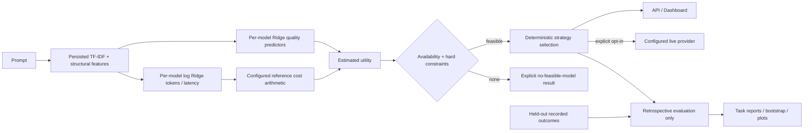

# Architecture and trust boundaries

No observed response, quality, token usage or latency enters the inference feature interface.
The ten structural features are word/character/line/question/digit counts, code fences, braces,
colons, semicolons and parentheses. Log counts are standardized on training prompts. Word
TF-IDF uses 1–2 grams and at most 6,000 features. Both transforms are persisted with predictors.

`training.py` uses grouped validation inside the original training split to choose a Ridge alpha
for each model from {1, 10, 100}. The strongest baseline is selected on validation macro task
score. Final transforms and predictors refit on cleaned training only. Quality predictions are
clipped to [0,1]. Token/latency models predict log1p targets; inverses are nonnegative and bounded
for numerical stability. These are simple point estimates, not calibrated billing or latency bounds.

`routing.py` implements a common Router protocol and five deployable strategies. Cheapest uses
estimated token cost, strongest uses the validation-fixed reference, random is seeded per prompt,
rule uses length/code structure to choose cheapest or the strong reference, and ML maximizes
quality minus normalized estimated cost/latency. No external routing implementation is copied.
Cost and latency scales are positive p95 values calculated on training observations; ratios can
exceed one. Candidate filtering never changes those scales. Ties are resolved deterministically.

All strategies honor estimated hard constraints and availability. If the strongest reference is
excluded or infeasible, that strategy returns no feasible model. No constraint is silently relaxed.
The oracle exists only in `evaluation.py` and chooses using observed test outcomes as a labeled
upper bound. It cannot be requested through the API or live provider interface.

## Application and security

CLI commands, API and evaluation reuse the same predictor/router. Streamlit calls the authenticated
API for routing and reads computed report artifacts for exploration. No static prediction fixture
stands in for the ML pipeline. The API loads only the operator-selected local joblib path.
Joblib can execute code; never load untrusted downloaded artifacts.

All data endpoints require a local bearer token. Keep both processes on localhost. This safeguard
is not multi-user authorization, rate limiting or Internet-facing production authentication.
Request fields have size/numeric limits and forbid unknown fields. Provider endpoint URLs,
model identifiers, prices and key environment variable names come only from operator configuration.
The API does not accept caller-supplied URLs or keys. Live mode is off by default, uses a finite
timeout, makes one request without automatic paid retries, validates usage and returns measured
latency and configured-price cost. No fake response is returned in disabled-live mode.
Operational JSON logs contain strategy/model/provider IDs, usage and timing, never prompts or keys.
Configuring a live alias must preserve correspondence with the trained candidate identity.
